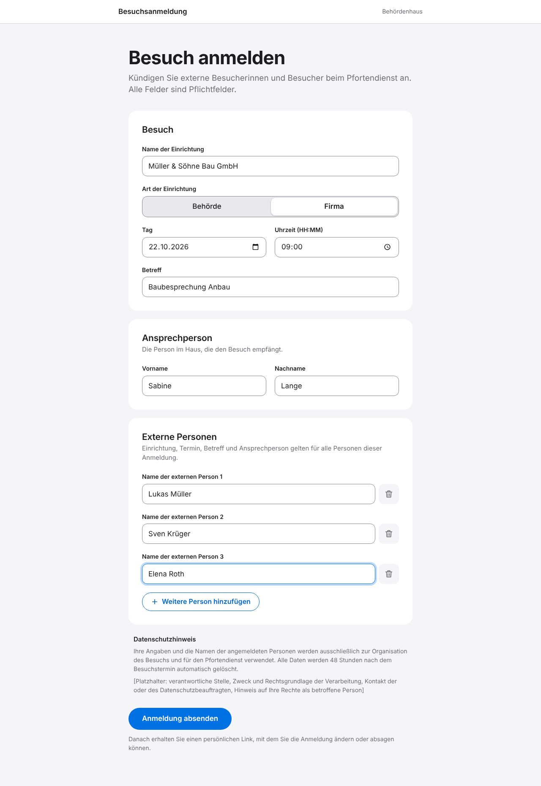
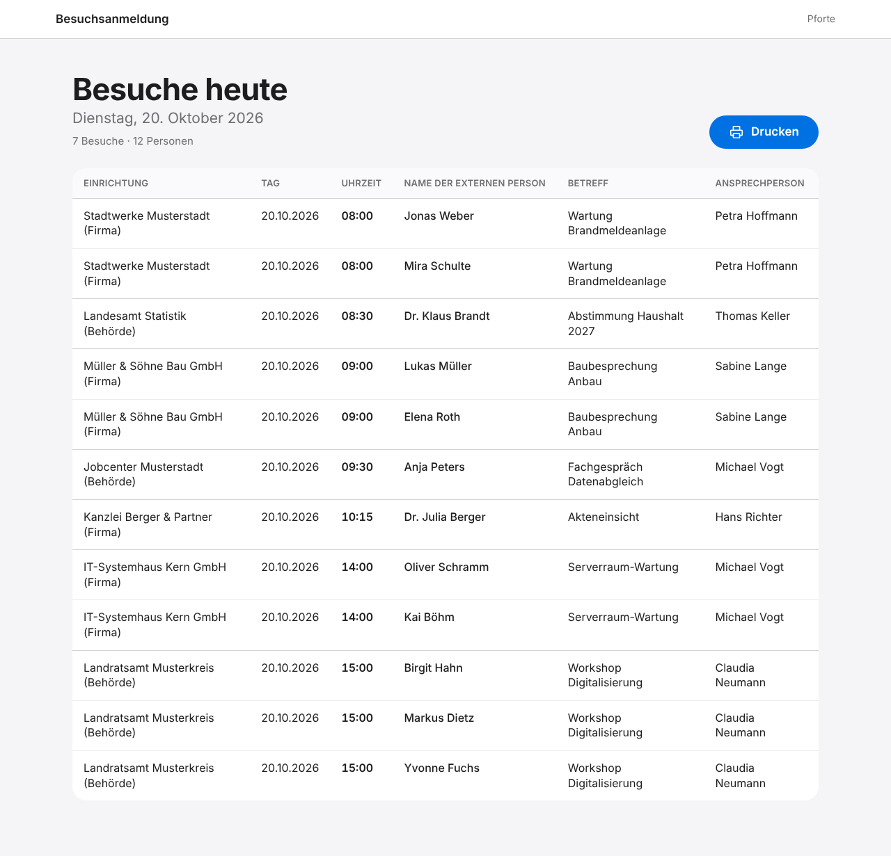

# Besucheranmeldung

Schlanke Web-Anwendung zur Anmeldung externer Besucherinnen und Besucher.
Beschäftigte kündigen Besuche über ein öffentliches Formular an, der
Pfortendienst sieht eine druckbare Tagesliste aller Besuche des heutigen Tages.

Reines PHP ohne Framework und ohne Composer, MariaDB, Oberfläche auf Deutsch,
Zeitzone Europe/Berlin. Keine externen Dienste, keine CDNs, keine Webfonts.

## Die beiden Links

| Wer | Link |
|---|---|
| Beschäftigte (Anmeldeformular, öffentlich) | `https://besuch.example.de/` |
| Pfortendienst (Tagesliste, geheim) | `https://besuch.example.de/pforte.php?key=<PFORTEN-TOKEN>` |

`besuch.example.de` durch die eigene Adresse ersetzen, `<PFORTEN-TOKEN>` durch
den Wert von `pforte_token` aus `config/config.php`. Ohne gültigen Token
antwortet `pforte.php` mit HTTP 403 und zeigt nichts an.

Nach dem Absenden erhalten Beschäftigte zusätzlich einen persönlichen
Bearbeitungslink (`/bearbeiten.php?token=…`), mit dem sie die Anmeldung ändern
oder absagen können.

## Ansichten

Screenshots aller Seiten liegen in [`docs/screenshots/`](docs/screenshots/), die Druckansicht der
Tagesliste als PDF in [`docs/screenshots/10-pforte-druck-A4-quer.pdf`](docs/screenshots/10-pforte-druck-A4-quer.pdf).
Die ursprüngliche Anforderung steht in [`docs/vibe-coding-prompt.md`](docs/vibe-coding-prompt.md).

| Formular | Tagesliste der Pforte |
|---|---|
|  |  |

## Ordnerstruktur

```
besucherverwaltung/
├── public/                  ← einziges öffentlich erreichbares Verzeichnis (DocumentRoot)
│   ├── index.php            Anmeldeformular
│   ├── bestaetigung.php     Bestätigung mit persönlichem Bearbeitungslink
│   ├── bearbeiten.php       Anmeldung ändern oder absagen
│   ├── pforte.php           Tagesliste für den Pfortendienst (Token-geschützt)
│   ├── assets/              app.css, print.css (A4 quer), app.js
│   └── .htaccess            Apache-Einstellungen für public/
├── app/                     interne Dateien (nicht öffentlich)
│   ├── bootstrap.php        Konfiguration laden, Zeitzone, Start jeder Seite
│   ├── lib/                 Datenbank, Sicherheit, Validierung, Bereinigung, Formate
│   ├── views/               HTML-Vorlagen
│   └── texte/datenschutzhinweis.html   ← Datenschutzhinweis, frei editierbar
├── config/
│   ├── config.example.php   Vorlage für die Konfiguration
│   └── config.php           eigene Konfiguration (nicht im Repository)
├── deploy/nginx.conf.example  Beispielkonfiguration für nginx
├── docs/                    Screenshots und ursprüngliche Anforderung
├── cleanup.php              Bereinigung für den Cronjob
├── schema.sql               Datenbankschema
└── .htaccess                Fallback, falls der DocumentRoot nicht auf public/ zeigen kann
```

## Voraussetzungen

- PHP 8.3 oder neuer mit den Erweiterungen `pdo_mysql` und `mbstring`
- MariaDB 10.11 (LTS) oder neuer
- Apache 2.4 (mit `mod_rewrite` und `mod_headers`) oder nginx mit PHP-FPM
- ein TLS-Zertifikat: **Die Anwendung ist nur für den Betrieb über HTTPS vorgesehen.**
  Bearbeitungs- und Pforten-Link enthalten geheime Tokens, die ohne HTTPS
  mitgelesen werden könnten.

## Installation

### 1. Dateien ablegen

```bash
cd /var/www
git clone https://github.com/DeGi20021983/Besucherverwaltung.git besucherverwaltung
```

### 2. Datenbank anlegen

```bash
sudo mariadb <<'SQL'
CREATE DATABASE besucher CHARACTER SET utf8mb4 COLLATE utf8mb4_unicode_ci;
CREATE USER 'besucher'@'localhost' IDENTIFIED BY 'ein-sicheres-passwort';
GRANT SELECT, INSERT, UPDATE, DELETE ON besucher.* TO 'besucher'@'localhost';
SQL

sudo mariadb --default-character-set=utf8mb4 besucher < /var/www/besucherverwaltung/schema.sql
```

### 3. Konfiguration

```bash
cd /var/www/besucherverwaltung
cp config/config.example.php config/config.php
chmod 640 config/config.php
chgrp www-data config/config.php
```

In `config/config.php` eintragen:

- `db`: Zugangsdaten der Datenbank
- `base_url`: öffentliche Adresse, z. B. `https://besuch.example.de`
- `pforte_token`: geheimer Token für die Tagesliste (siehe unten)
- `ip_hash_key`: geheimer Schlüssel für das Rate Limiting (siehe unten)
- `timezone`: `Europe/Berlin`

### 4. Pforten-Token erzeugen

```bash
php -r 'echo bin2hex(random_bytes(32)), PHP_EOL;'
```

Die Ausgabe (64 Zeichen) als `pforte_token` eintragen. Für `ip_hash_key` den
Befehl ein zweites Mal ausführen und einen anderen Wert verwenden. Der
Pforten-Link lautet dann `https://besuch.example.de/pforte.php?key=<Token>`.
Soll der Link ungültig werden (z. B. weil er weitergegeben wurde), einfach
einen neuen Token erzeugen und eintragen.

### 5. Webserver einrichten

**Apache:** Den `DocumentRoot` auf `public/` setzen und `.htaccess` erlauben:

```apache
<VirtualHost *:443>
    ServerName besuch.example.de
    DocumentRoot /var/www/besucherverwaltung/public
    <Directory /var/www/besucherverwaltung/public>
        AllowOverride All
        Require all granted
    </Directory>
    # Zugriffsprotokoll abschalten: es enthielte IP-Adressen und Tokens aus den URLs
    CustomLog /dev/null common
    SSLEngine on
    SSLCertificateFile    /etc/letsencrypt/live/besuch.example.de/fullchain.pem
    SSLCertificateKeyFile /etc/letsencrypt/live/besuch.example.de/privkey.pem
</VirtualHost>
```

```bash
sudo a2enmod rewrite headers ssl && sudo systemctl reload apache2
```

Kann der `DocumentRoot` nicht auf `public/` gesetzt werden (z. B. bei
Webspace), leitet die `.htaccess` im Hauptverzeichnis alle Aufrufe nach
`public/` um; `config/` und `app/` sind zusätzlich durch eigene
`.htaccess`-Dateien gesperrt.

**nginx:** Siehe [`deploy/nginx.conf.example`](deploy/nginx.conf.example).
`root` zeigt auf `public/`, nur die vier Seiten werden an PHP-FPM übergeben,
das Zugriffsprotokoll ist abgeschaltet.

### 6. Cronjob für die Datenlöschung

```cron
# Stündlich abgelaufene Besucherdaten und Rate-Limit-Einträge löschen
0 * * * * www-data php /var/www/besucherverwaltung/cleanup.php
```

(als Datei `/etc/cron.d/besucheranmeldung`; mit `-v` gibt das Skript die
Anzahl gelöschter Einträge aus). Die Anwendung führt die Bereinigung
außerdem bei jedem Seitenaufruf aus, sodass die Löschung auch ohne Cronjob
erfolgt.

### 7. Datenschutzhinweis anpassen

Der Text im Formular steht in `app/texte/datenschutzhinweis.html` und kann
direkt bearbeitet werden (einfaches HTML).

## Funktionen im Überblick

- **Anmelden:** Einrichtung (Name, Behörde/Firma), Tag, Uhrzeit (HH:MM),
  Betreff, Ansprechperson (Vor- und Nachname) und beliebig viele externe
  Personen. Alle Felder sind Pflicht; Datum und Uhrzeit dürfen nicht in der
  Vergangenheit liegen. Die Prüfung erfolgt im Browser und verbindlich auf
  dem Server; Fehler stehen am jeweiligen Feld, Eingaben bleiben erhalten.
  Personen hinzufügen und entfernen funktioniert auch ohne JavaScript.
- **Ändern und Absagen:** über den persönlichen Bearbeitungslink. Absage =
  Löschung der Anmeldung mit allen Personen.
- **Tagesliste:** nur Besuche von heute, nach Uhrzeit sortiert, eine Zeile pro
  Person. Am Smartphone als Karten. Button „Drucken“ mit eigenem
  Druck-Stylesheet: A4 quer, nur Überschrift, Datum und Tabelle,
  Tabellenkopf wird auf Folgeseiten wiederholt.
- **Löschung:** 48 Stunden nach dem Besuchstermin (Datum + Uhrzeit) werden
  Anmeldung und Personen gelöscht, Rate-Limit-Einträge 48 Stunden nach ihrer
  Erfassung.

## Datenschutz und Sicherheit

- IP-Adressen werden nur für das Rate Limiting verwendet und nur als HMAC-Hash
  mit Zeitstempel gespeichert (Tabelle `rate_limit`), Löschung nach 48 Stunden.
  Standard: höchstens 20 Absendungen pro Stunde und IP (`rate_limit` in der
  Konfiguration).
- Keine weiteren Logs mit personenbezogenen Daten, kein Tracking, keine
  externen Ressourcen. Die Zugriffsprotokolle des Webservers sollten
  abgeschaltet sein (siehe Beispiele oben), da sie IP-Adressen und die Tokens
  aus den URLs enthalten würden.
- Die Session dient nur dem CSRF-Schutz und enthält keine Besucherdaten.
- Alle Datenbankzugriffe über PDO mit Prepared Statements.
- Alle Ausgaben von Nutzereingaben über `htmlspecialchars`.
- CSRF-Token in allen Formularen, Honeypot-Feld gegen Bots.
- Tokens werden mit `random_bytes` erzeugt (256 Bit) und mit `hash_equals`
  verglichen. Von Bearbeitungs-Tokens wird nur der SHA-256-Hash gespeichert.
- Sicherheits-Header: Content-Security-Policy (ohne Inline-Skripte und
  -Styles), X-Frame-Options, X-Content-Type-Options,
  `Referrer-Policy: no-referrer` (Tokens in URLs werden nicht weitergegeben),
  HSTS bei HTTPS, `Cache-Control: no-store`.

## Hinweis zu sehr vielen Personen

Es gibt keine Höchstzahl an Personen pro Anmeldung. PHP begrenzt die Anzahl
der Formularfelder über `max_input_vars` (Standard 1000), das reicht für
mehrere Hundert Personen pro Anmeldung.

## Lokal ausprobieren

```bash
php -S 127.0.0.1:8080 -t public
```

Dafür in `config/config.php` `base_url` auf `http://127.0.0.1:8080` setzen.
